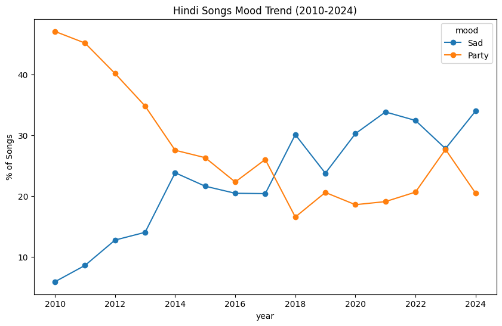

# Hindi Songs Mood Trend Analysis (2010–2024)

## Problem Statement 

Have Hindi (Bollywood) songs become more "sad" or more "party"/upbeat over the last decade and a half? Is there a visible shift in the emotional tone of mainstream Hindi music between 2010 and 2024?

## Data Source

- **Dataset:** [Spotify Tracks Dataset (Updated Every Week)](https://www.kaggle.com/) by gauthamvijayaraj on Kaggle — ~60,000 tracks across 6 languages (English, Hindi, Tamil, Telugu, Malayalam, Korean) with Spotify's audio-feature metrics per track.
- **Note on methodology:** Spotify deprecated its public Audio Features API endpoint for new developer apps in November 2024. This project therefore uses a pre-collected dataset that captured these features before the deprecation, rather than pulling live data via the API.
- Filtered to `language == 'Hindi'`, giving a working dataset of **2,374 tracks**.

## Tools Used

| Task | Tool |
|---|---|
| Data cleaning, filtering, mood classification logic | Python (pandas) |
| Aggregation queries, window functions | SQL (PostgreSQL) |
| Final dashboard (in progress) | Power BI |

## Data Cleaning

- Removed non-analytical columns: `artwork_url`, `track_url` (image/playback links with no analytical value).
- Kept `track_id`, `track_name`, `artist_name`, `album_name` as reference/display columns (not used in numeric analysis).
- Core analytical columns: `year`, `language`, `popularity`, `valence`, `energy`, `danceability`, `acousticness`, `speechiness`, `liveness`, `loudness`, `tempo`, `key`, `mode`, `time_signature`, `duration_ms`.
- Excluded years 2000–2009 from trend analysis due to very small sample sizes (as low as 1 track in some years), which would have produced misleading percentages.

## Mood Classification Method

Rather than relying on a single feature or arbitrary fixed thresholds, mood was derived from a **combined, data-driven score**:

1. Standardized (z-scored) three features: `valence` (happiness), `energy` (intensity), and `danceability`.
2. Averaged the three z-scores into a single `mood_score` per track.
3. Used the dataset's own quartiles to set classification thresholds:
   - Bottom 25% of `mood_score` → **Sad**
   - Top 25% of `mood_score` → **Party**
   - Middle 50% → **Neutral**

This avoids over-relying on `valence` alone (a low-valence but high-energy track — e.g. an intense/angry song — isn't necessarily "sad" in the party/relaxed sense this analysis cares about).

**Resulting distribution:** Sad = 598, Party = 594, Neutral = 1,182 — a reasonably balanced split, sense-checked manually by sampling songs from each category.

## Insights

There is a clear reversal in mood composition of Hindi songs between 2010 and 2024:

- **2010:** Party songs made up ~47% of releases vs. only ~6% Sad.
- **2018:** First crossover point — Sad songs (~30%) overtook Party songs (~17%) for the first time.
- **2024:** Sad songs (~34%) are now nearly **double** the share of Party songs (~20%).

The shift wasn't gradual and steady — it happened fastest between 2010–2013, briefly reversed around 2018–2019, and reasserted itself afterward, with 2023 showing a near-equal split before diverging again in 2024.

## Trend Chart

## SQL Analysis

Performed in PostgreSQL on the cleaned, classified dataset (`songs` table, 2,374 rows):

- Year-wise mood counts (`GROUP BY year, mood`) — replicated the Python trend to cross-validate results.
- Top 10 saddest/most upbeat tracks by `valence`.
- Average `tempo`, `energy`, `danceability` by mood category — Party songs show meaningfully higher averages across all three vs. Sad songs.
- Window function (`RANK() OVER (PARTITION BY year ORDER BY COUNT(*) DESC)`) — identified the dominant mood per year.
- Bonus check: relationship between musical `mode` (major/minor key) and mood classification.

## Limitations

- Classification into Sad/Party/Neutral is a modeling choice based on quartiles of a combined score, not an official Spotify label or ground truth — a different threshold or feature weighting could shift results slightly.
- This shows **correlation/pattern over time**, not causation. Possible explanations (e.g. rise of non-film/independent music, streaming-era listening habits, lo-fi trends) are hypotheses, not proven by this data.
- The 2018–2019 dip and 2023 near-equal split could reflect genuine short-term shifts or noise from a smaller yearly sample — not treated as conclusive on their own.

## Next Steps

- Build an interactive Power BI dashboard consolidating the trend chart, mood-vs-audio-feature comparisons, and top tracks per category.
- Extend the same pipeline to another language in the dataset for comparison.
